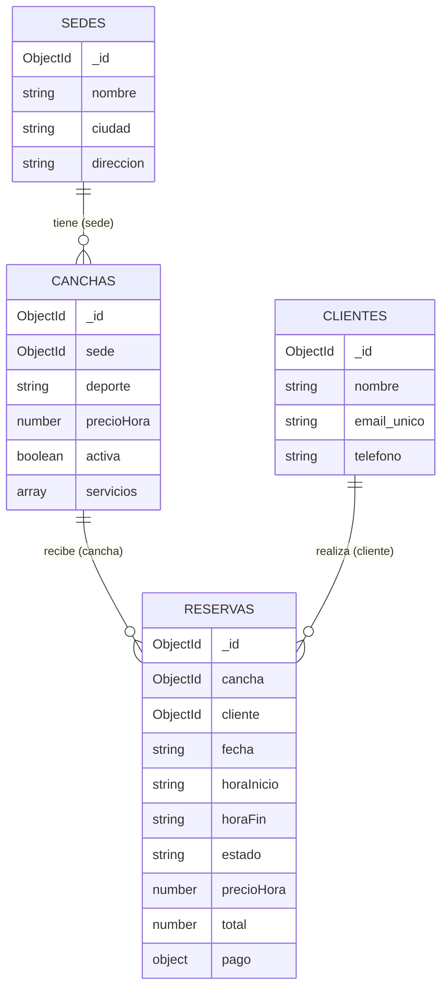

# Arquitectura y modelo de datos

## Flujo de una operación (ej.: crear una reserva)
Interfaz (`public/js/app.js`) → `fetch POST /api/reservas` → **routes** → **controller** → **service** (reglas de negocio) → **model** (Mongoose) → **MongoDB Atlas** → respuesta JSON → tabla actualizada.

| Capa | Carpeta | Responsabilidad |
|---|---|---|
| Rutas | `src/routes` | Asocia URL y método HTTP con un controlador |
| Controladores | `src/controllers` | Reciben la petición y devuelven la respuesta |
| Servicios | `src/services` | Reglas de negocio, validaciones y consultas |
| Modelos | `src/models` | Esquemas, validaciones de campo e índices |
| Middlewares | `src/middlewares` | Manejo central de errores |
| Config | `src/config` | Variables de entorno y conexión a Atlas |

## Modelo (colecciones)

- **Referencing:** `canchas.sede`, `reservas.cancha`, `reservas.cliente` (entidades independientes que crecen y se reutilizan).
- **Embedding:** `canchas.servicios` (lista pequeña que siempre se lee con la cancha) y `reservas.pago` (subdocumento que no existe sin la reserva).
- **Copia histórica:** `reservas.precioHora` conserva el precio vigente al reservar.

## Reglas de negocio
Sin traslape de horarios por cancha y fecha · fecha no pasada · fin posterior a inicio · horario 06:00-23:00 · cancha disponible · correo único (índice unique) · no eliminar sede con canchas ni cancha/cliente con reservas.

## Reportes (`src/services/reportes.service.js`)
Aggregation Pipeline: ingresos por sede, canchas más reservadas, mejores clientes, ingresos por mes y reservas por estado (`$match`, `$lookup`, `$unwind`, `$group`, `$project`, `$sort`, `$limit`).
